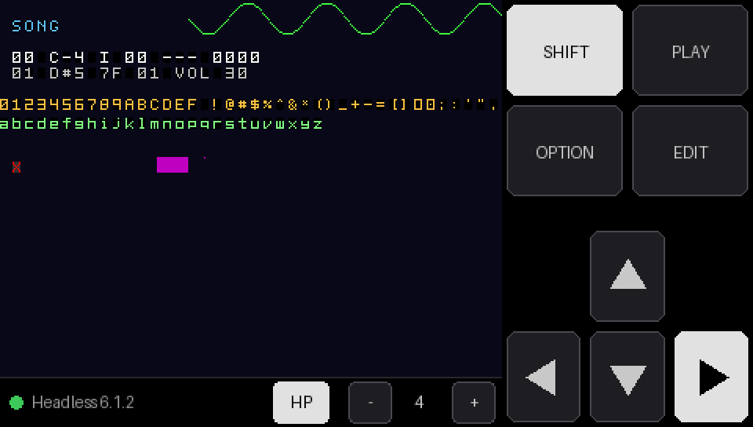

# microm8

Standalone firmware that turns an **M5Stack Tab5** (ESP32-P4) into a battery-powered handheld
for the **Dirtywave M8 Headless** running on a Teensy 4.1.

The Teensy plugs into the Tab5's USB-A port. The Tab5 powers it, renders the M8's screen,
plays its audio through the speaker or headphone jack, and sends key presses from an
on-screen multi-touch keypad laid out like the real M8.

The protocol handling comes from [m8c](https://github.com/laamaa/m8c), reimplemented for the
ESP32.



*Layout preview with SHIFT and RIGHT held. The M8 area shows test output from the unit-test
harness.*

## Layout

The Tab5's 5" screen is used in portrait (720×1280):

- **M8 screen at 2×** (640×480) at the top, a clean integer scale of the Headless's 320×240.
- **Status bar:** connection and firmware version, battery level, speaker/headphone toggle,
  volume.
- **The M8's own key layout** along the bottom: the cursor keys as an inverted T, SHIFT/PLAY
  directly under DOWN/RIGHT, and OPTION/EDIT up and to the right of UP, as on the hardware.
  Keys are 144 px (about 12.5 mm).

To turn the layout upside down, uncomment `-DTAB5_ROTATE_180=1` in `platformio.ini`.

## Controls

- **Keys:** every key a finger is touching counts as held, so M8 combos work as on the
  hardware: hold SHIFT, EDIT or OPTION and tap or hold a cursor key. Each key's touch area
  reaches halfway into the gap around it, so near misses still count without neighbouring
  keys overlapping.
- **SPK / HP:** chooses the speaker or the headphone jack. Plugging headphones in switches to
  them automatically, and unplugging switches back. Each output keeps its own volume.
- **Volume:** `−`/`+` (0–10). Volumes and the selected output are saved to flash.

## Hardware setup

- **M8:** connect the Teensy 4.1's micro-USB to the Tab5's **USB-A** port with a data cable.
  The Tab5 supplies 5 V on that port, so the Teensy needs no other power.
- **USB-C:** charging, flashing and serial logs. It's a separate USB controller from the M8's
  port, so logs work while the M8 is connected.
- **Battery:** the Tab5's NP-F550 pack powers everything.

## Building and flashing

You need [PlatformIO](https://platformio.org/). The project uses the
[pioarduino](https://github.com/pioarduino/platform-espressif32) platform (Arduino core 3.x
on ESP-IDF 5.5), because the stock PlatformIO platform's ESP-IDF 4.4 USB host stack can't do
isochronous transfers, which USB audio needs.

```bash
pio run -t upload -t monitor
```

The first build takes several minutes: `custom_sdkconfig` makes pioarduino rebuild the Arduino
core from ESP-IDF source (see [Troubleshooting](#troubleshooting)). Later builds take seconds.

### Tests

The M8 protocol parser and framebuffer renderer have host-side unit tests:

```bash
pio test -e native
```

## Architecture

| Module | Role |
|---|---|
| `src/usb/m8_usb.cpp` | USB host client on the P4's high-speed controller. Finds the M8's serial and audio interfaces by parsing descriptors, sets DTR/RTS and line coding, keeps bulk and isochronous transfers in flight. Replaces m8c's libusb backend. The M8's descriptor is decoded in [docs/m8-headless-usb.md](docs/m8-headless-usb.md). |
| `src/m8/slip.c`, `protocol.cpp` | SLIP framing and parsing of M8 commands: rectangle, character, oscilloscope and system info. Ported from m8c. |
| `src/m8/screen.cpp` | 320×240 RGB565 framebuffer in PSRAM, drawn with m8c's semantics: font offsets, background-colour tracking, scope clearing. Uses m8c's five bitmap fonts. Tracks changed regions as 8-row bands. |
| `src/display/ui.cpp` | Portrait layout through M5GFX: scales changed bands 2× to the display at up to 60 Hz, draws the keypad and status bar. `splash.cpp` shows the splash and on-screen log while no M8 is connected. |
| `src/input/touch.cpp`, `keypad.cpp`, `keypad_layout.cpp` | Multi-touch through M5Unified, and key hit-testing. Produces the M8 key bitmask (`'C'` + mask). |
| `src/audio/audio_out.cpp` | Ring buffer for USB audio, clock-drift compensation (drops or repeats single frames), a silence gate so the codec goes quiet between songs, per-output volume levels, mono mix for the speaker. |
| `src/audio/audio_hw.cpp` | ES8388 codec on I2S0. Volume is set in the codec's analog output stage, so its noise floor drops with the volume. Speaker amp enable, headphone detect. |
| `src/board.cpp` | M5Unified bring-up, USB-A 5 V, battery gauge, and the lock for the shared internal I2C bus. |

FreeRTOS tasks: USB and audio run on core 0; display and touch run on core 1. Serial data
passes from USB to the UI task through a stream buffer, so a slow display update never stalls
USB.

## Status

**Working on the Tab5:** the M8 connects over high-speed USB, and its screen, keys, and audio
through the speaker and headphones all work.

### Roadmap

- **Sampling into the M8:** stream the Tab5's ES7210 microphones to the M8's USB audio input
  (asynchronous, with a rate-feedback endpoint).
- **USB MIDI keyboard on USB-C:** run the P4's second USB controller as a host and forward a
  keyboard's MIDI to the M8's USB MIDI input. Open question: whether USB-C can supply 5 V to
  a bus-powered keyboard.

## Troubleshooting

**While no M8 is connected, the M8 area shows the last 12 log lines**, so many problems can be
diagnosed without a computer. Errors are red and warnings amber.

**"Waiting for M8" and the `port:` log line shows `connected=0` the whole time.** The Tab5
sees nothing on the data lines. The cable is probably charge-only, or the Teensy isn't
running M8 Headless. Test both by plugging the Teensy into a computer with the same cable and
checking that m8c finds it.

**The log shows `ENUM: Abort request of enumeration process (0x48a:0x16c0)`.** ESP-IDF
rejected the device because no enumeration filter approved it. The Arduino core enables the
filter hook, and ESP-IDF then rejects anything a filter hasn't approved. The firmware
installs a filter that accepts all devices; if you see this, that code is missing.

**The log shows `Configuration descriptor larger than control transfer max length`.** The
USB stack's control-transfer limit is too small for the M8's 376-byte descriptor.
`platformio.ini` raises it through `custom_sdkconfig`. Check that setting is still there and
do a clean build (`pio run -t clean`, then build again).

**The build fails with `No module named 'SCons.Tool.FortranCommon'` (or another SCons
error).** pioarduino swaps build-tool versions during a build, mostly on the first run after
`custom_sdkconfig` changes, and with more than one PlatformIO Core installed. Run the build
again. If it keeps happening, delete `~/.platformio/packages/tool-scons` and retry.

## History

microm8 began on a Guition JC4827W543 (ESP32-S3, 4.3" 480×272). That version rendered the M8
and took touch input, but the S3's USB is full-speed only. The M8's audio is timed for
high-speed USB, so a full-speed host receives only about an eighth of it, and the Headless
doesn't output audio on I2S either. That's why the project moved to the Tab5. The
JC4827W543 code remains in the git history: commit `0821825` is the last version with it.

## License

Portions are derived from m8c, the SLIP decoder and M5Unified (all MIT). See
[LICENSE-THIRD-PARTY.md](LICENSE-THIRD-PARTY.md).
