# microm8

**A battery-powered and microcontroller-based handheld for the Dirtywave M8 Headless.**

<p align="center">
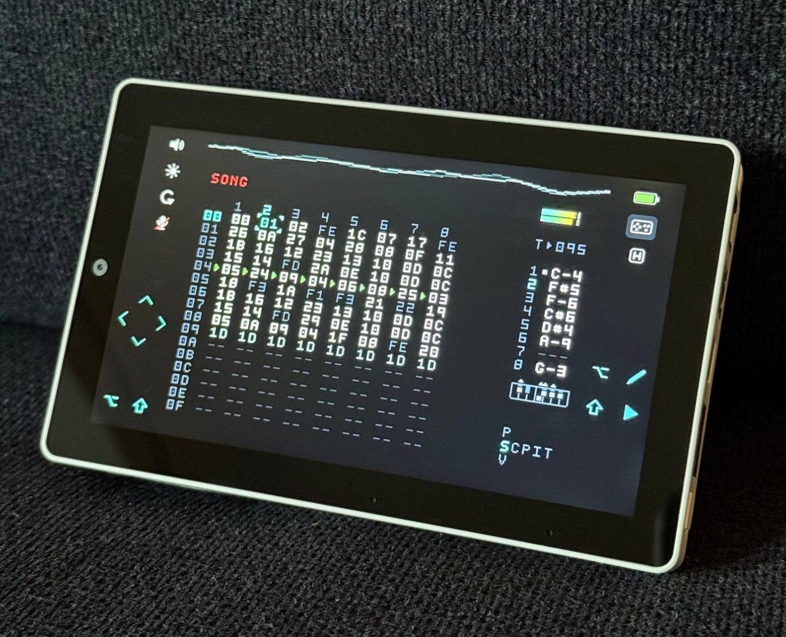
</p>

microm8 is firmware for the [M5Stack Tab5](https://shop.m5stack.com/products/m5stack-tab5-iot-development-kit-esp32-p4)
that turns it into a portable M8. Plug a Teensy 4.1 running
[M8 Headless](https://github.com/Dirtywave/M8HeadlessFirmware) into the Tab5's USB-A port and
you get the M8 on a 5" touchscreen, with a speaker, a headphone jack, two microphones for
sampling, and a battery that powers the Teensy too. Nothing to configure, no computer needed after flashing.

Plug the Tab5 into a computer and the M8 shows up there as well, as if it were connected
directly, while the Tab5 keeps playing.

> [!IMPORTANT]
> **The M8 is Trash80's work, and the real thing is better.** microm8 only exists because
> Dirtywave publishes M8 Headless for free. The M8 hardware, with its real keys, its build
> quality, its I/O ports, and its battery life, is and always will be the best way to play
> the M8, and the M8 app is the best way to take it anywhere on your phone. If you enjoy
> microm8, please support the person who made all of it:
>
> - [**M8 Tracker Model:02**](https://dirtywave.com/products/m8-tracker-model-02) from Dirtywave
> - [**M8 Music Tracker**](https://apps.apple.com/us/app/id6806721202) for iPhone and iPad

## Features

**The headless experience in your hands.** The M8's screen is scaled up to 2.25× in portrait and 3× in
landscape, with sharp text and silent touch controls on a device that's not trying to pop up email
and text alerts.

**Two key layouts, any orientation.** Use the M8's own key arrangement, or a compact layout
with an arrow pad under one thumb and the M8's OPTION, EDIT, SHIFT and PLAY under the other.
Turn the Tab5 any way you like and the screen follows, or lock it when you want it to stay put.

<table>
<tr><th>M8 layout</th><th>Compact layout</th></tr>
<tr>
<td>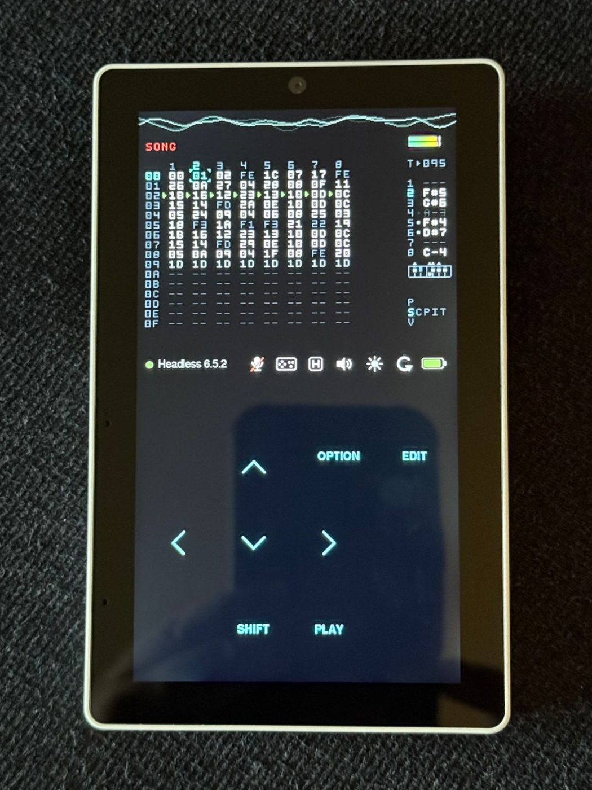</td>
<td>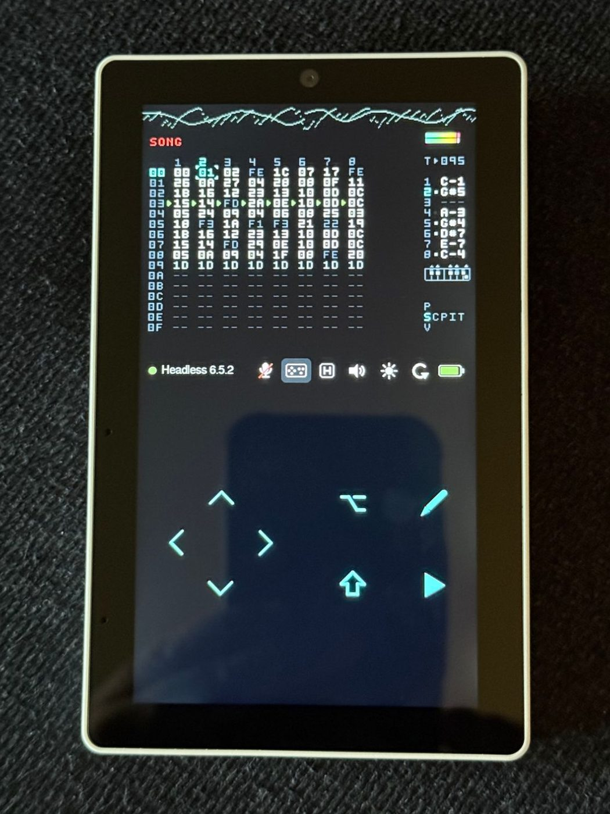</td>
</tr>
<tr>
<td>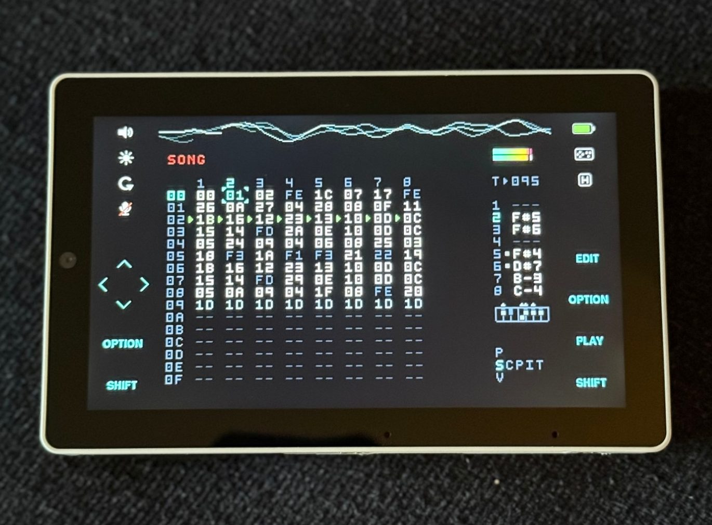</td>
<td>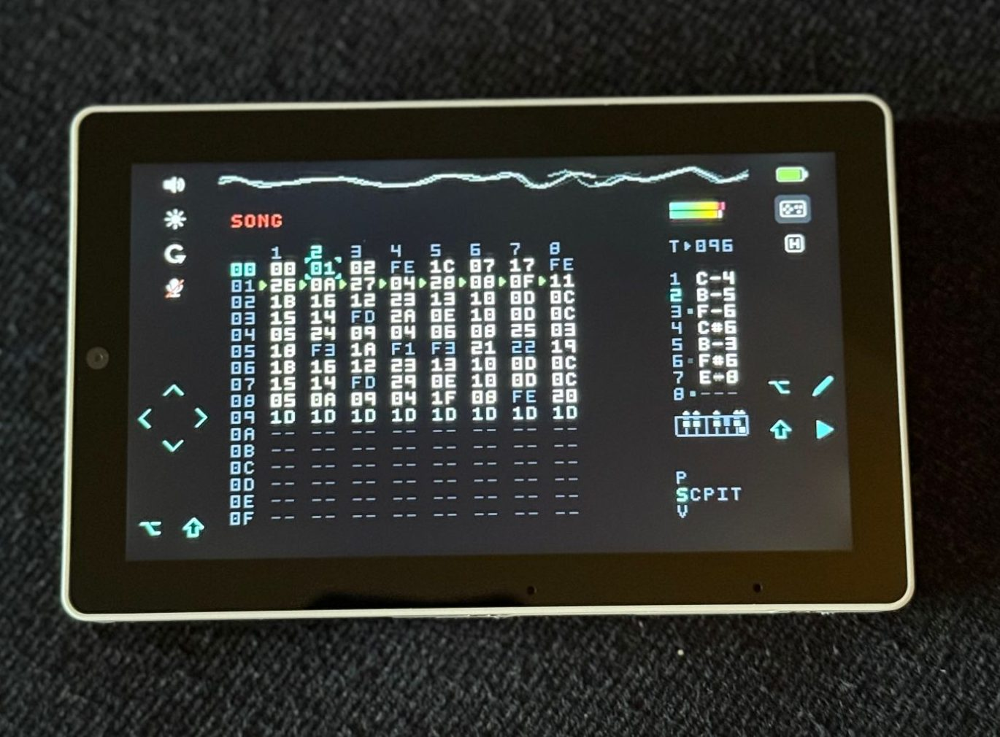</td>
</tr>
</table>

**Sound everywhere.** The Tab5's speaker for quick ideas, the 3.5 mm jack for everything else.
Headphone detection picks the right output, and we save a separate volume setting for each.

**Sample ready.** The Tab5's two microphones record in stereo straight into the M8's
sampler. Enable the mics when you're ready, and the M8's built-in input volume setting controls
levels. If it's not getting sensitive enough, try adding some boost in microm8's mic menu.

**Your computer, too.** The Tab5's USB-C port passes the M8 through to a computer. Open
[m8.run](https://m8.run) and edit on a big screen with a real keyboard, record the M8's audio
in your DAW, or drive your DAW's instruments from the M8's USB MIDI, all while the Tab5 keeps
showing and playing the M8. Keys pressed on the computer and on the touchscreen combine.
See [Using a computer](#using-a-computer).

**One-hand key combos.** HOLD mode turns SHIFT and OPTION into tappable toggles, so you can play any
combo with one or two fingers.

**Runs on a camera battery.** The Tab5 runs from a standard NP-F550 camera battery and powers
the Teensy from it. Playing at full brightness, the whole thing draws about 3 W, which works out to
roughly four hours on the stock 2000 mAh pack (estimated from measured power draw). Charge over
USB-C, even while you play. Around 7-8 hours of battery life with brightness turned down. The Tab5
_dumps_ heat when you set the brightness at full, so keeping it low is nicer anyway.

## What works

<table>
<tr><th>✅ Working</th><th>❌ Not working</th></tr>
<tr>
<td valign="top">

- M8 screen, keys and audio
- M8 and compact key layouts
- Auto-rotate to any orientation
- Rotation lock
- Multi-touch key combos
- Gesure-based arrow controls in landscape
- HOLD for one-handed combos
- Onboard speaker
- 3.5 mm headphones
- Headphone detection
- Stereo sampling with the dual mics
- USB-C passthrough to a computer
- USB MIDI through passthrough
- Battery level and charging status
- Charging over USB-C while playing
- Volume and brightness controls
- Settings saved across restarts

</td>
<td valign="top">

- USB MIDI devices on USB-C 🧪
- USB-C headphones 🧪
- Computer audio into the M8 over passthrough 🧪
- USB hubs on the USB-A port
- Bluetooth headphones (A2DP over BLE)
- Bluetooth headphones (A2DP over Bluetooth Classic) ⛔

<br>

🧪 Might be possible or requires custom wiring; needs testing.<br>
⛔ Never. The Tab5's hardware can't do it. Womp womp.

</td>
</tr>
</table>

## Getting started

### What you need

- An **[M5Stack Tab5 Kit](https://shop.m5stack.com/products/m5stack-tab5-iot-development-kit-esp32-p4)**.
  Choose the option with the NP-F550 battery, unless you already have one.
- A **[Teensy 4.1](https://www.pjrc.com/store/teensy41.html)** running M8 Headless, with a
  microSD card. Dirtywave's
  [M8 Headless setup guide](https://github.com/Dirtywave/M8Docs/blob/main/docs/M8HeadlessSetup.md)
  covers everything.
- A **micro-USB to USB-A data cable**. A short one is easiest to carry. Some cables only carry
  power; those won't work.
- A computer with **Chrome or Edge**, for flashing.

### 1. Set up the Teensy

Follow the [M8 Headless setup guide](https://github.com/Dirtywave/M8Docs/blob/main/docs/M8HeadlessSetup.md):
download the latest firmware and flash it onto the Teensy with TyUploader (part of TyTools),
and prepare its microSD card.

### 2. Flash microm8 onto the Tab5

1. Download `microm8-tab5.bin` from the [latest release](../../releases/latest).
2. If the Teensy is plugged into the Tab5, unplug it. Connect the Tab5's USB-C port to your
   computer and turn the Tab5 on.
3. Open Espressif's web flasher, [ESP Tool](https://espressif.github.io/esptool-js/), in Chrome
   or Edge.
4. Click **Connect** and choose the Tab5 (it shows up as a USB JTAG/serial debug unit).
5. Set **Flash Address** to `0x0` (it starts out as `0x1000`), choose `microm8-tab5.bin` as the
   **File**, and click **Program**.
6. When it finishes, press the Tab5's reset button.

The Tab5 shows the microm8 splash screen, waiting for the M8.

### 3. Plug in and play

Plug the Teensy into the Tab5's **USB-A** port. The Tab5 powers it, and the M8 appears a few
seconds later. Done, go play.

<p align="center">
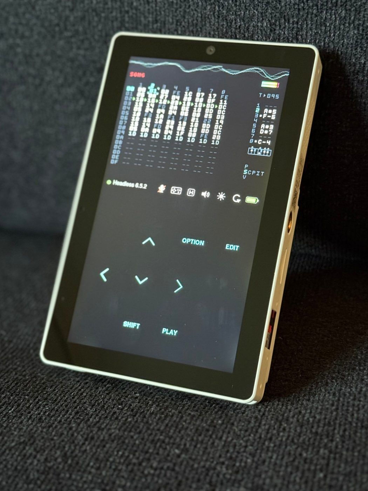
</p>

Want it all in one piece, with no cable hanging off the side? See
[Going cable-free](#going-cable-free-optional).

## Controls

Every key a finger is touching counts as held, so M8 combos work as they do on the hardware:
hold SHIFT, EDIT or OPTION and tap or hold an arrow. Keys light up white while held, with their
touch area outlined.

The status icons sit under the M8 screen in portrait and in the side margins in landscape.

| Icon | What it does |
|---|---|
| Speaker or headphones | Volume, and the choice of speaker or headphones. |
| Sun | Screen brightness. Dimming also saves power. |
| Circular arrow | Locks or unlocks rotation (crossed out in red while locked). |
| Microphone | Turns the mics on or off, and sets their boost (struck through while off, red while live). |
| Key layout | Switches between the M8 and compact layouts (lit while compact). |
| H key cap | HOLD (filled while on). |
| Battery | Charge level, colored green to red, or a bolt while charging. Tap for details. |

Tapping an icon opens its controls under the status bar (or left panel in landscape)
without covering the M8 screen. They close automatically or when you tap the icon again.
All settings are saved except the mic, which starts off at every power-on so the speaker
can't surprise you by feeding back into it.

**Arrows in landscape:** tap the arrow pad, or swipe anywhere on the left half of the screen
(the M8 screen included) and keep your finger down to hold the arrow.

**HOLD:** while HOLD is on, a tap on SHIFT or OPTION keeps it held until you tap it again,
whatever you press in between: SHIFT, then RIGHT, RIGHT, RIGHT, then SHIFT again. HOLD stays
on until you tap its icon.

### Recording from the mics

1. Tap the mic icon and switch the mics on. The icon turns red.
2. In the M8's sample recorder, set SRC to Line (L&R) or MIC (on the Headless they're the same input).
3. Set the level with the recorder's VOL. A0 works well for a voice within about a foot. If
   you go to DD and that's still not enough, the mic row's boost adds +6 or +12 dB digitally.

The left and right mics record as a stereo pair. The quality on this thing is surprisingly good.

## Using a computer

While the M8 is connected, plug the Tab5's USB-C port into a computer. The computer sees the M8
exactly as if it were plugged in directly: same name, same serial port, and its audio as a
44.1 kHz stereo input called "M8". The Tab5 keeps showing the M8 and playing its audio
throughout.

- **[m8.run](https://m8.run)** and other M8 tools connect as usual. Keys pressed on the
  computer and on the touchscreen combine, so you can hold SHIFT on the Tab5 and press an arrow
  on the keyboard.
- **Your DAW** can record the M8's audio and use its USB MIDI, in both directions.
- **Closing m8.run** doesn't turn off the M8's screen on the Tab5.
- **Charging** works as usual: the computer's port charges the Tab5.

Sending audio from the computer into the M8 doesn't work yet: the Tab5's second USB
controller has no endpoint left for the feedback channel the M8's audio input uses. Record into the M8 from the Tab5's mics instead, or power down
and pull its SD card to drop on samples.

## Going cable-free (optional)

<p align="center">
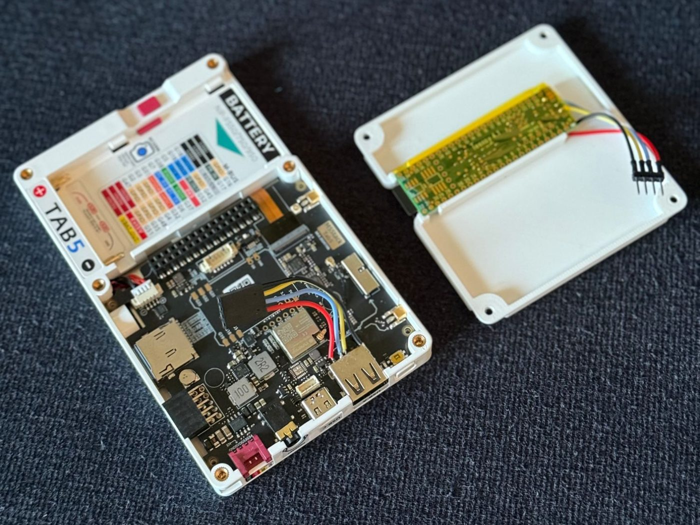
</p>

With some soldering, the Teensy can live inside the Tab5. A 3D-printed backplate replaces the
Tab5's back cover and holds the Teensy, with a short 4-wire lead to the Tab5's USB-A port. The
backplate model is on [Printables](https://www.printables.com/model/1878492-microm8-backplate-for-m5stack-tab5).

<p align="center">
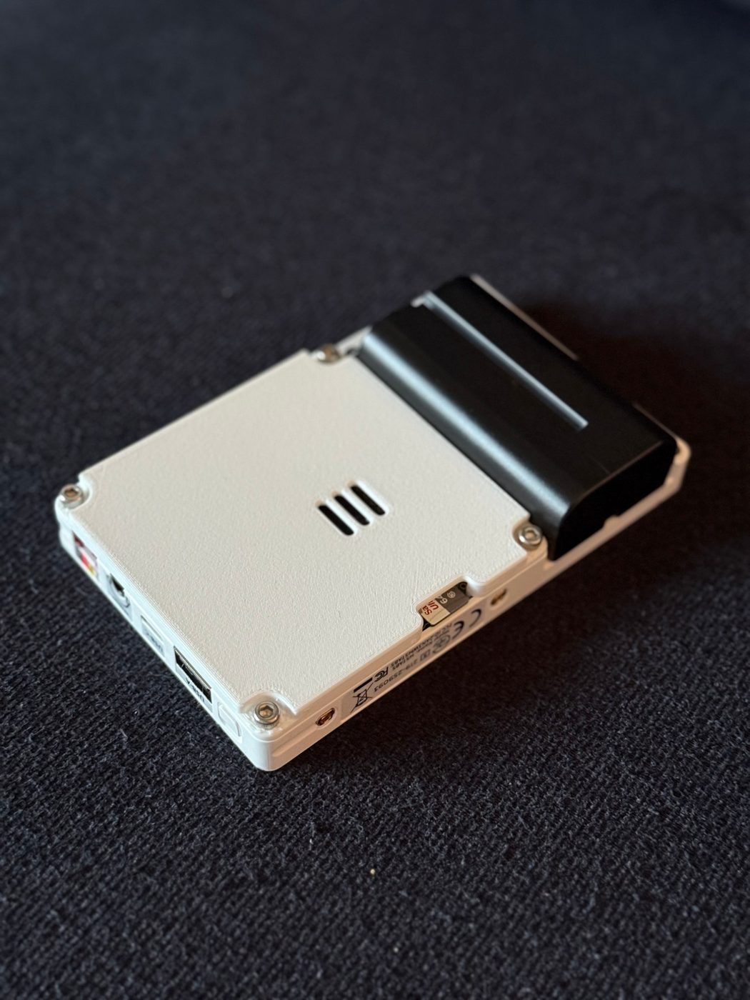
</p>

**You'll need:**

- The [printed backplate](https://www.printables.com/model/1878492-microm8-backplate-for-m5stack-tab5), and four M3×6 mm socket-head screws to hold it on. PETG recommended for flexibility and heat resistance.
- Four short wires
- Optionally, a 4-pin connector, such as a Dupont housing
- Optionally, Kapton tape (polymide film tape as wide as the Teensy)

**Wiring:** connect the four USB lines of the Tab5's USB-A port to the Teensy: 5 V, D−, D+ and
ground. On the Teensy, 5 V goes to the VBUS pin and ground to a GND pin; the data lines go to the
two pads right behind the micro-USB connector on the underside. In the photos, red is 5 V,
black is ground, blue is D-, yellow is D+. Refer to the [Teensy pinout](https://www.pjrc.com/teensy/pinout.html)
to be sure you're soldering to the right place. Red on the Teensy should go to VBUS, not 5V or VIN.

**Assembly:** the Teensy snaps right in. Ensure you're putting the microSD card side of the Teensy
at the edge with the cutout, and press into place.

<table>
<tr>
<td>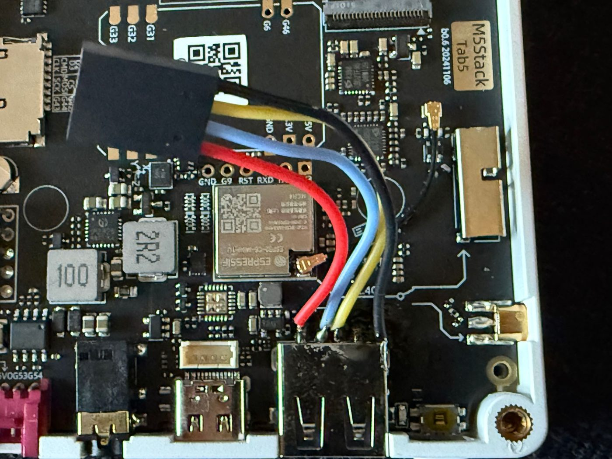</td>
<td>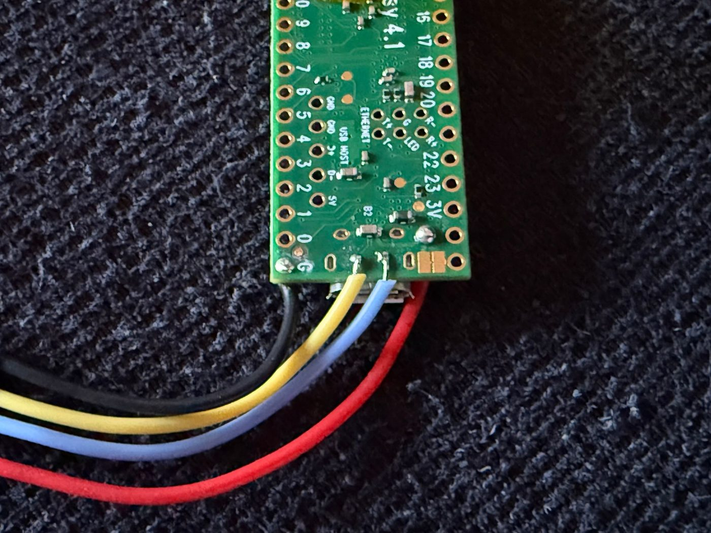</td>
</tr>
<tr>
<td colspan="2" align="center">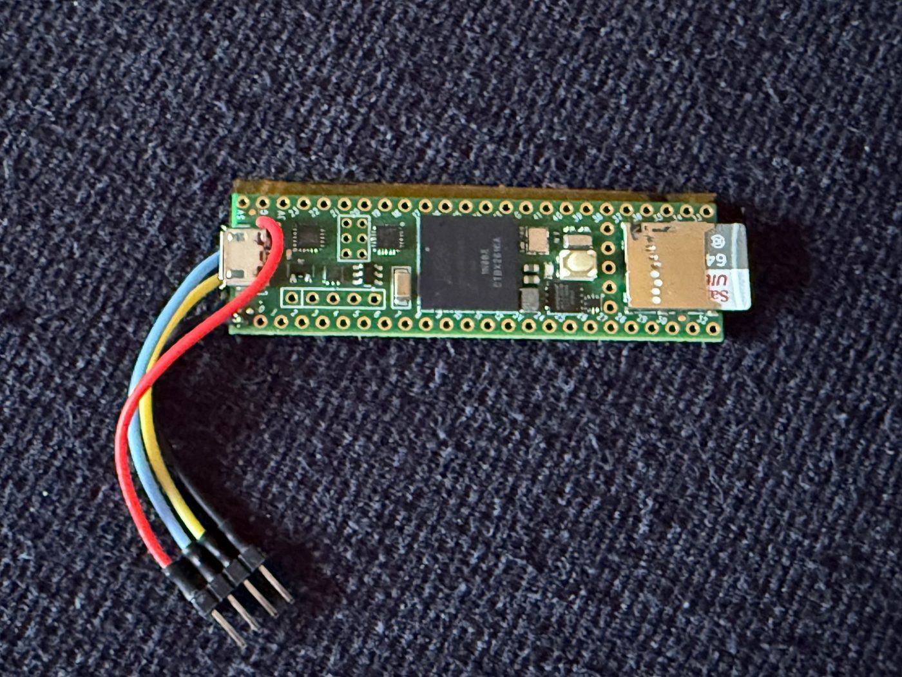</td>
</tr>
</table>

Tips:

- **Ground:** the USB-A port's ground pin sinks a lot of heat and is hard to solder. The port's
  metal housing is also ground, and the bottom of the housing takes solder much more easily.
  I attached my black wire straight to that housing on the right side. All grounds are connected
  on the Tab5, so you can connect to any GND point.
- **Leave a way to connect a cord.** To update M8 Headless, the Teensy has to be plugged into a
  computer by its micro-USB port, and _ideally_ it shouldn't be wired to the Tab5 at the same time. A
  connector in the lead, like the crimped Dupont connector in the photos, makes that easy. Any
  flat 4-pin connector works, but if it's bulky it may not fit under the backplate. If you don't
  have a connector, that's ok: Leave space to get a micro-USB cable plugged in, and always disconnect
  the battery from the Tab5 before doing that.
- **Kapton tape** along the underside of the Teensy keeps its pads from shorting against the
  Tab5's internals, in particular the Tab5's microSD card holder. It's optional, but
  recommended. Any heat-resistant polymide film tape works.

## Troubleshooting

**In general: the M8 area shows a log.** While no M8 is connected, the Tab5 shows its latest log lines in
the M8 area, so you can see what's going on without a computer. Errors are red and warnings
amber.

**"Connect M8 Headless" stays on screen:** The Tab5 doesn't see the Teensy. The cable is
probably power-only, or the Teensy isn't running M8 Headless. Try the same cable between the
Teensy and a computer, and check that [m8.run](https://m8.run) finds the M8.

**The web flasher can't connect:** Unplug the Teensy from the Tab5 first: while the M8 is
connected, the Tab5's USB-C port is the M8, not the Tab5.

**The Tab5 doesn't start after flashing, and the web flasher reported chip revision v3.x:**
`microm8-tab5.bin` is built for ESP32-P4 chip revisions before v3. Each release also has
`microm8-tab5-rev3.bin`, the same firmware built for v3 chips. I don't know if the Tab5 ships
with newer revisions, and I don't have one to test with, so it's untested. If you try it,
please open an issue and let me know how it went. PRs happily accepted, too.

---

## Building from source

The project uses the [pioarduino](https://github.com/pioarduino/platform-espressif32)
platform (Arduino core 3.x on ESP-IDF 5.5), because the stock PlatformIO platform's ESP-IDF
4.4 USB host stack can't do isochronous transfers, which USB audio needs. pioarduino needs its
own fork of PlatformIO Core, **pioarduino** 6.2.0 or later. Install it with either:

- the [pioarduino IDE](https://marketplace.visualstudio.com/items?itemName=pioarduino.pioarduino-ide)
  extension for VS Code (or Cursor), which puts `pio` in `~/.platformio/penv/bin`, or
- `pipx install pioarduino` for the command line.

Use one or the other, not the upstream PlatformIO Core (`brew install platformio`, `pip install
platformio`) or the PlatformIO IDE extension. All of them share `~/.platformio`, and the two
cores want different versions of the same build tools, so having both around breaks builds in
confusing ways. `pio --version` should report 6.2.0 or later.

```bash
pio run -t upload -t monitor
```

The first build takes several minutes: `custom_sdkconfig` makes pioarduino rebuild the Arduino
core from ESP-IDF source. Later builds take seconds. Every build also writes
`.pio/build/tab5/firmware.factory.bin`, the single image (flashed at `0x0`) that releases ship
as `microm8-tab5.bin`. The `tab5_r3` env builds the same firmware for chip revision v3.

Pushing a version tag (`v1.0.0`, ...) runs `.github/workflows/release.yml`, which runs the
tests, builds both images and publishes them as a GitHub release.

While the M8 is connected, USB-C is the M8 rather than the Tab5's serial port. Either unplug
the M8, or run `python3 tools/passthru.py serial` (needs `brew install libusb`), which gives
USB-C back to the serial port until the M8 reconnects or the Tab5 restarts. Flashing restarts
the Tab5, which then passes the M8 through again. To keep USB-C as the serial port at all
times, set `MICROM8_USB_PASSTHROUGH` to 0 in `src/config.h`.

### Tests

The M8 protocol parser and framebuffer renderer have host-side unit tests:

```bash
pio test -e native
```

### Screenshots

`tools/screenshot.py` saves exactly what's on the screen as a PNG over the USB-C serial port.
It needs only Python 3, on macOS or Linux. Close any serial monitor first.

```bash
python3 tools/screenshot.py landscape.png
```

<table>
<tr>
<td></td>
<td></td>
</tr>
</table>

### Build options

- `-DTAB5_ROTATE_180=1` in `platformio.ini` turns portrait upside down.
- `-DTAB5_HP_DET_INSERTED_LEVEL=-1` turns off automatic speaker/headphone switching.
- If tilting picks the wrong orientation, the `TAB5_GRAVITY_*` settings in `src/config.h` map
  the accelerometer's axes to orientations; the log's `orientation:` lines show the readings.
- `-DMICROM8_POWER_DIAG=1` shows the power drawn from the battery in the status bar, logs a
  power summary every 10 seconds, and measures at boot what switching off unused hardware
  saves. Only meaningful on battery.

### Build problems

**The build fails with `No module named 'SCons.Tool.FortranCommon'`, or PlatformIO says the
platform needs a newer core.** You're building with the upstream PlatformIO Core, or another
copy of it is running too (often the PlatformIO IDE extension), and it's swapping out the build
tools pioarduino installed. Build with the pioarduino core only; see
[Building from source](#building-from-source).

**The log shows `Configuration descriptor larger than control transfer max length`.** The
USB stack's control-transfer limit is too small for the M8's 376-byte descriptor.
`platformio.ini` raises it through `custom_sdkconfig`. Check that setting is still there and
do a clean build (`pio run -t clean`, then build again).

**The log shows `ENUM: Abort request of enumeration process (0x48a:0x16c0)`.** ESP-IDF
rejected the device because no enumeration filter approved it. The firmware installs a filter
that accepts all devices; if you see this, that code is missing.

## How it works

The Tab5's ESP32-P4 has a high-speed USB host controller on its USB-A port. The M8 Headless
enumerates there as a composite device: a serial port carrying its display protocol and key
input, USB audio in both directions, and USB MIDI (decoded in
[docs/m8-headless-usb.md](docs/m8-headless-usb.md)). microm8 draws the M8's screen from the
serial data, plays its audio through the Tab5's codec, and sends key presses back.

| Module | Role |
|---|---|
| `src/usb/m8_usb.cpp` | USB host client on the P4's high-speed controller. Finds the M8's serial and audio interfaces by parsing descriptors, sets DTR/RTS and line coding, keeps bulk and isochronous transfers in flight, and forwards the M8's USB MIDI for passthrough. While the mic is on, streams to the M8's audio input, sizing each packet from the M8's rate feedback. |
| `src/usb/passthru.cpp` | USB passthrough on USB-C. While an M8 is connected, swaps the P4's two full-speed PHYs so its OTG 1.1 controller drives USB-C (the Serial/JTAG controller moves to the PHY on the I2S pins, with its pads off), then runs a TinyUSB device with the M8's identity: one class driver owns the whole configuration (CDC serial, UAC2 audio to the computer, USB MIDI), numbered as on the M8 except audio, which uses endpoint 0x81 (the controller has TX FIFOs for IN endpoints 1-4 only). Vendor requests read audio counters and hand USB-C back to Serial/JTAG (`tools/passthru.py`). Copies of the M8's serial, audio and MIDI go to the computer; the computer's commands go to the M8, with its key state merged into the touch keys and its disconnect command dropped. Audio packets are queued from the USB interrupt, 44 or 45 frames per 1 ms, adjusted to keep about 10 ms buffered. |
| `src/m8/slip.c`, `protocol.cpp` | SLIP framing and parsing of M8 commands: rectangle, character, oscilloscope and system info. |
| `src/m8/screen.cpp` | 320×240 RGB565 framebuffer in PSRAM: font offsets, background-color tracking, scope clearing, and the M8's five bitmap fonts. Tracks changed regions as 8-row bands. |
| `src/display/ui.cpp` | Portrait and landscape layouts. Changed areas of the M8 screen are scaled (pixel-area resampling) in the panel's native orientation into internal RAM, then copied into the panel's framebuffer by the DSI driver's 2D DMA, timed against the panel's scan so updates don't tear. Keys, status icons, the control rows and the landscape arrow pad are drawn through M5GFX. `splash.cpp` shows the splash and on-screen log while no M8 is connected. |
| `src/input/touch.cpp`, `keypad.cpp`, `keypad_layout.cpp` | Multi-touch through M5Unified, and the portrait and landscape key layouts and hit-testing. `main.cpp` gives each finger a role (keys, slider, swipe, arrow pad) and produces the M8 key bitmask (`'C'` + mask). |
| `src/audio/audio_out.cpp` | Ring buffer for USB audio, clock-drift compensation (drops or repeats single frames), a silence gate so the codec goes quiet between songs, per-output volume levels, mono mix for the speaker. |
| `src/audio/audio_hw.cpp` | ES8388 codec on I2S0. Volume is set in the codec's analog output stage, so its noise floor drops with the volume. Speaker amp enable, headphone detect. The ES7210 mic ADC on the same bus. |
| `src/audio/mic.cpp` | Mic capture: reads the mics into a buffer that the USB task drains at the M8's rate, dropping or repeating single frames to absorb clock drift. Optional digital boost. |
| `src/board.cpp` | M5Unified bring-up, USB-A 5 V, and the lock for the shared internal I2C bus. Switches off hardware microm8 doesn't use (the ESP32-C6 wireless chip and the camera). Battery state from the INA226 current sensor: charging, plugged in, or no battery. |

FreeRTOS tasks: USB (host and passthrough) and audio run on core 0; display and touch run on
core 1. Serial data passes from USB to the UI task through a stream buffer, so a slow display
update never stalls USB.

Working on microm8 with an AI agent? Point it at [AGENTS.md](AGENTS.md).

## Credits

- **[Dirtywave](https://dirtywave.com)** and Trash80, for the M8, and for releasing M8
  Headless so projects like this can exist. Please [buy an M8](https://dirtywave.com/products/m8-tracker-model-02)
  or [the app](https://apps.apple.com/us/app/id6806721202).
- **[m8c](https://github.com/laamaa/m8c)** by Jonne Kokkonen (laamaa), the original M8
  Headless client. microm8's protocol handling, drawing rules and fonts are adapted from it,
  and most M8 Headless clients since learned the protocol from it. Thank you, laamaa. And also
  for your fire releases on [your Bandcamp](https://laamaa.bandcamp.com) and including your bundles!
  Despite putting this device together, I'm still terrible at composing on the M8 but I learn so much
  from those songs. Snowy Day is playing in all the photos.
- **[M5Stack](https://m5stack.com)**, for the Tab5 and the M5Unified and M5GFX libraries.
- **[pioarduino](https://github.com/pioarduino/platform-espressif32)**, for keeping the
  current Arduino core and ESP-IDF available in PlatformIO.
- **[TinyUSB](https://github.com/hathach/tinyusb)**, behind the USB passthrough.
- Marcin Borowicz, for the [SLIP decoder](https://github.com/marcinbor85/slip).
- Claude, because the deep USB magic here was uncharted territory for me at the start of this project.

## License

MIT; see [LICENSE](LICENSE). Portions are derived from m8c, the SLIP decoder and M5Unified
(all MIT); see [LICENSE-THIRD-PARTY.md](LICENSE-THIRD-PARTY.md).
