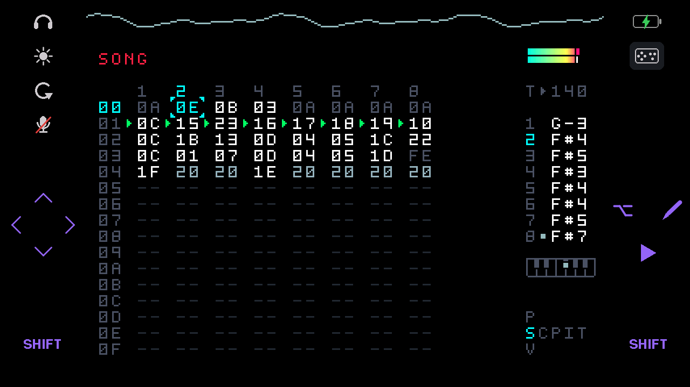
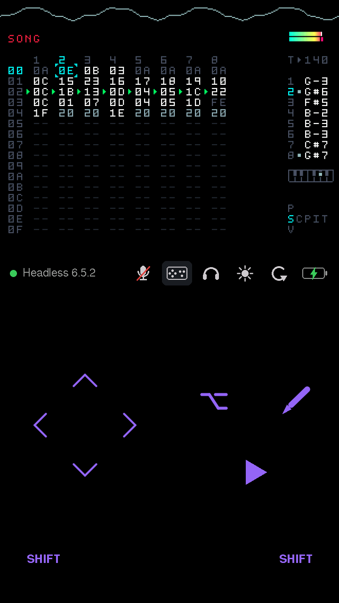

# microm8

Standalone firmware that turns an **M5Stack Tab5** (ESP32-P4) into a battery-powered handheld
for the **Dirtywave M8 Headless** running on a Teensy 4.1.

The Teensy plugs into the Tab5's USB-A port. The Tab5 powers it, renders the M8's screen,
plays its audio through the speaker or headphone jack, and sends key presses from an
on-screen multi-touch keypad. It works in portrait, with the M8's own key layout, and in
landscape, with a bigger M8 screen and keys at the sides.

The protocol handling comes from [m8c](https://github.com/laamaa/m8c), reimplemented for the
ESP32.

<p>


</p>

*Landscape and portrait, with compact keys. Screenshots from the device (see
[Screenshots](#screenshots)).*

## Layout

The screen follows the Tab5's accelerometer through all four orientations. The rotation icon
locks it; tap it again to unlock. The lock and the last orientation are saved.

The M8's 320×240 screen is scaled with pixel-area resampling. Each display pixel averages the
M8 pixels it covers, so text stays sharp at non-integer scales.

**Portrait** (720×1280):

- **M8 screen at 2.25×** (720×540) across the full width at the top.
- **Status bar:** connection and firmware version on the left; volume, brightness, rotation
  and power icons on the right.
- **The M8's own key layout** along the bottom: the cursor keys as an inverted T, SHIFT/PLAY
  directly under DOWN/RIGHT, and OPTION/EDIT up and to the right of UP, as on the hardware.
  Keys are 144 px (about 12.5 mm).

**Landscape** (1280×720):

- **M8 screen at 3×** (960×720), centred.
- **Left margin:** the volume, brightness and rotation icons; under them a panel with the
  arrow pad (or an open slider, the power details or a message); SHIFT in the bottom-left
  corner.
- **Right margin:** the power and key layout icons; under them EDIT, OPTION, PLAY and SHIFT,
  stacked up from the bottom-right corner.
- No connection text, to keep the margins clear.

**Compact keys** (the key layout icon toggles them, in either orientation): a pad for each
thumb. The arrows sit in a diamond on the left; OPTION, EDIT and PLAY (⌥, a pencil, ▶) sit in a
triangle on the right, at the same height; SHIFT stays in both bottom corners. In portrait the
pads replace the M8 keypad; in landscape the triangle replaces the right-hand column.

Keys are drawn as a purple label or symbol; while held, they turn white and their touch area
is outlined.

To turn portrait upside down, uncomment `-DTAB5_ROTATE_180=1` in `platformio.ini`. If tilting
picks the wrong orientation, the `TAB5_GRAVITY_*` settings in `src/config.h` map the
accelerometer's axes to orientations; the log's `orientation:` lines show the readings.

## Controls

- **Keys:** every key a finger is touching counts as held, so M8 combos work as on the
  hardware: hold SHIFT, EDIT or OPTION and tap or hold a cursor key. Each key's touch area
  reaches halfway into the gap around it, so near misses still count without neighbouring
  keys overlapping.
- **Arrows in landscape:**
  - **Arrow pad:** the four arrows in the left panel. Each arrow owns a triangle of the
    panel, cut by the diagonals of the square around the arrows, so the whole panel is
    touchable. The compact OPTION/EDIT/PLAY triangle works the same way, in three equal
    wedges.
  - **Swipes:** swipe right, left, up or down anywhere on the left half of the screen (the M8
    screen included). Keep the finger down to hold the arrow; lifting it releases.
- **Volume icon** (a speaker, or headphones when they're the output): opens a row with an
  output selector (speaker and headphones, the selected one lit) and a volume slider (0–10).
  Plugging headphones in switches to them automatically, and unplugging switches back; at
  power-on the output follows the jack. Each output keeps its own volume.
- **Brightness icon** (sun): opens a brightness slider. The lowest step is 30%, where the
  backlight stops dimming. Dimming also cuts power: about 0.8 W between 30% and full.
- **Rotation icon:** locks or unlocks rotation (crossed out in red when locked).
- **Key layout icon:** switches compact keys on or off (lit while on).
- **Power icon:** a battery filled and coloured by charge (green when full, yellow around
  half, red when low); an empty battery with a green bolt while charging; a full battery with
  a light bolt when plugged in and full; a plug when no battery is fitted. Tap it for the
  details in words.
- **Sliders:** once a finger grabs a slider, the slider follows it until it lifts, wherever
  it moves. Slide your thumb off to see the knob.
- **Mic icon:** opens the mic row: an off/on switch and a boost selector (see Recording below).
  Struck through while off, red while live.
- Rows open under the status bar (in landscape, in the left panel) without covering the M8
  screen, and close when you tap the icon again or 4 seconds after the last touch. Volumes,
  output, brightness and mic boost are saved to flash.

## Recording

The Tab5's two microphones can be recorded on the M8 like any input:

1. Tap the mic icon and switch the mic on (it starts off at every power-on, so the speaker
   can't unexpectedly feed back into it). The icon turns red.
2. In the M8's sample recorder, set SRC to Line (or MIC: on the Headless they're the same
   input). The USB source records nothing from the Tab5.
3. Set the level with the recorder's VOL; FF gives a good level for speech within about a
   foot. If that's not enough, the mic row's boost adds +6 or +12 dB digitally, which raises
   the noise along with the signal.

The mics arrive as stereo (left and right mic), streamed to the M8's USB audio input at the
M8's own clock rate (from its feedback endpoint), so recordings don't crackle. Use headphones,
or turn the M8's input monitoring down, if the speaker feeds back into the mics.

## Hardware setup

- **M8:** connect the Teensy 4.1's micro-USB to the Tab5's **USB-A** port with a data cable.
  The Tab5 supplies 5 V on that port, so the Teensy needs no other power.
- **USB-C:** charging, flashing and serial logs. It's a separate USB controller from the M8's
  port, so logs work while the M8 is connected.
- **Battery:** the Tab5's NP-F550 pack powers everything.

## Building and flashing

You need [PlatformIO](https://platformio.org/). The project uses the
[pioarduino](https://github.com/pioarduino/platform-espressif32) platform (Arduino core 3.x
on ESP-IDF 5.5), because the stock PlatformIO platform's ESP-IDF 4.4 USB host stack can't do
isochronous transfers, which USB audio needs.

```bash
pio run -t upload -t monitor
```

The first build takes several minutes: `custom_sdkconfig` makes pioarduino rebuild the Arduino
core from ESP-IDF source (see [Troubleshooting](#troubleshooting)). Later builds take seconds.

### Tests

The M8 protocol parser and framebuffer renderer have host-side unit tests:

```bash
pio test -e native
```

### Screenshots

`tools/screenshot.py` saves exactly what's on the screen as a PNG, over the USB-C serial port
(it sends `S`; the firmware replies with its framebuffer, see `src/diag/screenshot.cpp`). It
needs only Python 3, on macOS or Linux. Close any serial monitor first, since the port can't be
shared:

```bash
python3 tools/screenshot.py landscape.png
```

## Architecture

| Module | Role |
|---|---|
| `src/usb/m8_usb.cpp` | USB host client on the P4's high-speed controller. Finds the M8's serial and audio interfaces by parsing descriptors, sets DTR/RTS and line coding, keeps bulk and isochronous transfers in flight. While the mic is on, streams to the M8's audio input, sizing each packet from the M8's rate feedback. Replaces m8c's libusb backend. The M8's descriptor is decoded in [docs/m8-headless-usb.md](docs/m8-headless-usb.md). |
| `src/m8/slip.c`, `protocol.cpp` | SLIP framing and parsing of M8 commands: rectangle, character, oscilloscope and system info. Ported from m8c. |
| `src/m8/screen.cpp` | 320×240 RGB565 framebuffer in PSRAM, drawn with m8c's semantics: font offsets, background-colour tracking, scope clearing. Uses m8c's five bitmap fonts. Tracks changed regions as 8-row bands. |
| `src/display/ui.cpp` | Portrait and landscape layouts. Changed areas of the M8 screen are scaled (pixel-area resampling) in the panel's native orientation into internal RAM, then copied into the panel's framebuffer by the DSI driver's 2D DMA, timed against the panel's scan so updates don't tear. Keys, status icons, the volume/brightness/power row and the landscape arrow pad are drawn through M5GFX. `splash.cpp` shows the splash and on-screen log while no M8 is connected. |
| `src/input/touch.cpp`, `keypad.cpp`, `keypad_layout.cpp` | Multi-touch through M5Unified, and the portrait and landscape key layouts and hit-testing. `main.cpp` gives each finger a role (keys, slider, swipe, arrow pad) and produces the M8 key bitmask (`'C'` + mask). |
| `src/audio/audio_out.cpp` | Ring buffer for USB audio, clock-drift compensation (drops or repeats single frames), a silence gate so the codec goes quiet between songs, per-output volume levels, mono mix for the speaker. |
| `src/audio/audio_hw.cpp` | ES8388 codec on I2S0. Volume is set in the codec's analog output stage, so its noise floor drops with the volume. Speaker amp enable, headphone detect. The ES7210 mic ADC on the same bus. |
| `src/audio/mic.cpp` | Mic capture: reads the mics into a buffer that the USB task drains at the M8's rate, dropping or repeating single frames to absorb clock drift. Optional digital boost. |
| `src/board.cpp` | M5Unified bring-up, USB-A 5 V, and the lock for the shared internal I2C bus. Switches off hardware microm8 doesn't use (the ESP32-C6 wireless chip and the camera). Battery state from the INA226 current sensor: charging, plugged in, or no battery. |

FreeRTOS tasks: USB and audio run on core 0; display and touch run on core 1. Serial data
passes from USB to the UI task through a stream buffer, so a slow display update never stalls
USB.

## Status

**Working on the Tab5:** the M8 connects over high-speed USB, and its screen, keys, and audio
through the speaker and headphones all work, as does recording from the Tab5's mics.

### Shelved ideas

- **USB MIDI devices on USB-C:** the P4's second (full-speed) USB controller could host a MIDI
  keyboard or a DIN-MIDI cable on the Tab5's USB-C port and forward to the M8's USB MIDI.
  Shelved because USB-C can't power them: it's the charger's input, so nothing on the Tab5
  supplies 5 V there, and feeding it from the Tab5's own 5 V would just charge the battery from
  itself. A hub on USB-A doesn't work either: ESP-IDF's USB host can't run a full-speed device
  through a high-speed hub (no transaction translator support) alongside the high-speed M8.
- **USB passthrough to a computer:** the same controller as a USB device on USB-C, so m8c or
  m8.run could use the M8 through the Tab5. Full speed has room for the M8's audio, but the
  port would lose the flashing and log console while in use.

## Troubleshooting

**Measuring power draw:** build with `-DMICROM8_POWER_DIAG=1`. The status bar then shows the
power drawn from the battery, the log prints a power summary every 10 seconds, and boot
measures what switching off the C6 and camera saves (about 0.2 W). Only meaningful on
battery.

**While no M8 is connected, the M8 area shows the last 12 log lines**, so many problems can be
diagnosed without a computer. Errors are red and warnings amber.

**"Waiting for M8" and the `port:` log line shows `connected=0` the whole time.** The Tab5
sees nothing on the data lines. The cable is probably charge-only, or the Teensy isn't
running M8 Headless. Test both by plugging the Teensy into a computer with the same cable and
checking that m8c finds it.

**The log shows `ENUM: Abort request of enumeration process (0x48a:0x16c0)`.** ESP-IDF
rejected the device because no enumeration filter approved it. The Arduino core enables the
filter hook, and ESP-IDF then rejects anything a filter hasn't approved. The firmware
installs a filter that accepts all devices; if you see this, that code is missing.

**The log shows `Configuration descriptor larger than control transfer max length`.** The
USB stack's control-transfer limit is too small for the M8's 376-byte descriptor.
`platformio.ini` raises it through `custom_sdkconfig`. Check that setting is still there and
do a clean build (`pio run -t clean`, then build again).

**The build fails with `No module named 'SCons.Tool.FortranCommon'` (or another SCons
error).** pioarduino swaps build-tool versions during a build, mostly on the first run after
`custom_sdkconfig` changes, and with more than one PlatformIO Core installed. Run the build
again. If it keeps happening, delete `~/.platformio/packages/tool-scons` and retry.

## History

microm8 began on a Guition JC4827W543 (ESP32-S3, 4.3" 480×272). That version rendered the M8
and took touch input, but the S3's USB is full-speed only. The M8's audio is timed for
high-speed USB, so a full-speed host receives only about an eighth of it, and the Headless
doesn't output audio on I2S either. That's why the project moved to the Tab5. The
JC4827W543 code remains in the git history: commit `0821825` is the last version with it.

## License

MIT; see [LICENSE](LICENSE). Portions are derived from m8c, the SLIP decoder and M5Unified
(all MIT); see [LICENSE-THIRD-PARTY.md](LICENSE-THIRD-PARTY.md).
